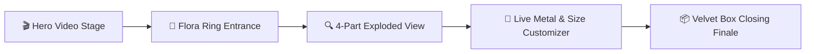

<div align="center">

# ✨ CALLA — LUXURY FINE JEWELLERY ✨
### *High-End Interactive 3D Web Experience & Fine Jewellery Atelier*

<p align="center">
  <b>Developed &amp; Engineered under <a href="#">Shaivika IT Technologies</a></b>
</p>

[](https://gold-rings-jeweller.vercel.app)
[](https://gold-rings-jeweller.vercel.app)
[](https://github.com/SHARABUMANOJKUMAR/Gold-Rings-Jeweller)
[](https://github.com/SHARABUMANOJKUMAR)

<br/>

<a href="https://gold-rings-jeweller.vercel.app" target="_blank">
  
</a>

<br/><br/>

> **"Fine jewellery that becomes you — Follow the Flora halo ring from the cinematic film to its velvet box."**

</div>

---

## 💎 Table of Contents

- [🌟 Live Demo & Deployment](#-live-demo--deployment)
- [✨ Key Highlights & Features](#-key-highlights--features)
- [🎬 Scrollytelling & 3D Interactive Animation Engine](#-scrollytelling--3d-interactive-animation-engine)
- [🛠️ Tech Stack & Architecture](#️-tech-stack--architecture)
- [🚀 Resolving Vercel 404 Deployment Issue](#-resolving-vercel-404-deployment-issue)
- [💻 Local Installation & Setup](#-local-installation--setup)
- [📂 Project Structure](#-project-structure)
- [🛡️ Brand & Watermark](#️-brand--watermark)

---

## 🌟 Live Demo & Deployment

| Resource | Link |
| :--- | :--- |
| **🌐 Production URL (Vercel)** | **[https://gold-rings-jeweller.vercel.app](https://gold-rings-jeweller.vercel.app)** |
| **📦 GitHub Repository** | **[https://github.com/SHARABUMANOJKUMAR/Gold-Rings-Jeweller](https://github.com/SHARABUMANOJKUMAR/Gold-Rings-Jeweller)** |
| **🏢 Parent Organization** | **Shaivika IT Technologies** |

---

## ✨ Key Highlights & Features

```
  ✦ ───────────────────────────────────────────────────────────── ✦
   💎 1.2 ct Centre Stone · F colour · VS1 clarity · Hand Set
   💍 10-Stone Petal Halo in Recycled 18k Yellow, White & Rose Gold
   🎞️ Cinematic Hero Film with Adaptive High-Density 4K Video Stream
   🌀 High-Precision 60fps Canvas Scrollytelling Frame Sequencing
   🔍 Dynamic Catalog with Instant Search, Filter Chips & Quick Modal
   🛍️ Persistent Shopping Bag & Wishlist Powered by LocalStorage
  ✦ ───────────────────────────────────────────────────────────── ✦
```

- **🎥 Cinematic Stage Video**: Seamlessly transitions between an ultra-high definition hero film and an interactive scroll journey.
- **🔬 4-Part Interactive Breakdown**: Inspect the ring's components (Centre Stone, Petal Halo, 18k Gold Petal Setting, and Pavé Band) dynamically synchronized to viewport scroll.
- **🎁 Finale Unboxing Experience**: Interactive animated ring box closing mechanism rendered on HTML5 Canvas.
- **✨ Customizer & Sizer**: Live metal tone selector (Yellow Gold, White Gold, Rose Gold) and ring sizing with automatic pricing recalculation.
- **🛒 Responsive E-Commerce Drawers**: Slide-out shopping bag and wishlist drawer with currency formatting (`₹ INR`).

---

## 🎬 Scrollytelling & 3D Interactive Animation Engine

The website uses a dedicated frame sequence renderer orchestrated by **GSAP** and **ScrollTrigger**:



- **Smooth Scroll Interpolation:** Powered by `Lenis` (lerp smoothing: `0.11`, wheel multiplier: `0.95`).
- **Canvas Dual-Buffer Rendering:** 1600x1600 high-res canvas with adaptive frame seeking (`Seq.at(t)`) for silky smooth 60fps playback without memory spikes.

---

## 🛠️ Tech Stack & Architecture

<div align="center">

| Technology | Role | Purpose |
| :--- | :--- | :--- |
| **HTML5 / CSS3** | Presentation Layer | Modern CSS variables, flexbox, grid, and fluid typography (`clamp`) |
| **JavaScript (ES6+)** | Interaction Layer | State persistence, customizer, modal dialogs, drawers |
| **GSAP & ScrollTrigger** | Animation Engine | Timeline pinning, scroll percentage tracking, and element reveals |
| **Lenis Scroll** | Physics Engine | Momentum-based, buttery smooth viewport scrolling |
| **Node.js (`tools/serve.mjs`)**| Streaming Server | HTTP server with full `Range: bytes` byte-range streaming for video |
| **Vercel** | Edge Hosting | Global CDN hosting with automated zero-config Git deployments |

</div>

---

## 🚀 Resolving Vercel 404 Deployment Issue

### Why did Vercel show `404: NOT_FOUND`?
By default, Vercel expects `index.html` to be present at the root directory (`./`). Because the project's web assets are organized inside the `site/` directory (`site/index.html`), Vercel initially deployed an empty root directory.

### How We Solved It:
1. **Added `vercel.json` Routing Configuration**:
   ```json
   {
     "$schema": "https://openapi.vercel.sh/vercel.json",
     "cleanUrls": true,
     "rewrites": [
       { "source": "/", "destination": "/site/index.html" },
       { "source": "/((?!site/).*)", "destination": "/site/$1" }
     ]
   }
   ```
   *This automatically routes incoming requests for `/`, `/css/*`, `/js/*`, and `/assets/*` straight into the `site/` directory.*

2. **Alternative (Dashboard Configuration)**:
   - Go to [Vercel Dashboard](https://vercel.com) → Select **Gold-Rings-Jeweller**.
   - Navigate to **Settings** → **General**.
   - Under **Root Directory**, click **Edit**, select or type **`site`**, and click **Save**.
   - Redeploy or trigger a git push.

---

## 💻 Local Installation & Setup

### Prerequisites
- [Node.js](https://nodejs.org) (v18 or newer)
- Git

### Quick Start

```bash
# 1. Clone the repository
git clone https://github.com/SHARABUMANOJKUMAR/Gold-Rings-Jeweller.git

# 2. Navigate to project directory
cd Gold-Rings-Jeweller

# 3. Start local development server
node tools/serve.mjs site 5533
```

Open your browser at:
👉 **`http://localhost:5533`**

---

## 📂 Project Structure

```text
Gold-Rings-Jeweller/
├── vercel.json               # Vercel deployment rewrites & routing
├── README.md                 # Complete project documentation & guide
├── site/                     # Production web application
│   ├── index.html            # Primary HTML structure
│   ├── css/
│   │   ├── style.css         # Typography, layout, and component styles
│   │   └── journey.css       # Scrollytelling, canvas stage, and pins
│   ├── js/
│   │   ├── main.js           # Cart, wishlist, quick-view, search
│   │   └── journey.js        # Canvas frame sequencing & ScrollTrigger
│   ├── vendor/               # GSAP, ScrollTrigger, Lenis
│   └── assets/               # 4K video, ring frames, box sequence, photos
├── tools/
│   └── serve.mjs             # Node.js HTTP server with range streaming
├── docs/
│   └── api.md                # Client storage & server documentation
└── .ai-session/
    └── state.json            # AI session tracking state
```

---

## 🛡️ Brand & Watermark

<div align="center">

```
  ╔════════════════════════════════════════════════════════════════════════════╗
  ║                                                                            ║
  ║                   ENGINEERED & PRODUCED UNDER                              ║
  ║                     SHAIVIKA IT TECHNOLOGIES                               ║
  ║                                                                            ║
  ║         Official Luxury Showcase Concept · All Rights Reserved             ║
  ║                                                                            ║
  ╚════════════════════════════════════════════════════════════════════════════╝
```

**Designed & Developed by [Shaivika IT Technologies](https://github.com/SHARABUMANOJKUMAR)**  
*For inquiries, custom web solutions, and luxury brand design systems.*

</div>
